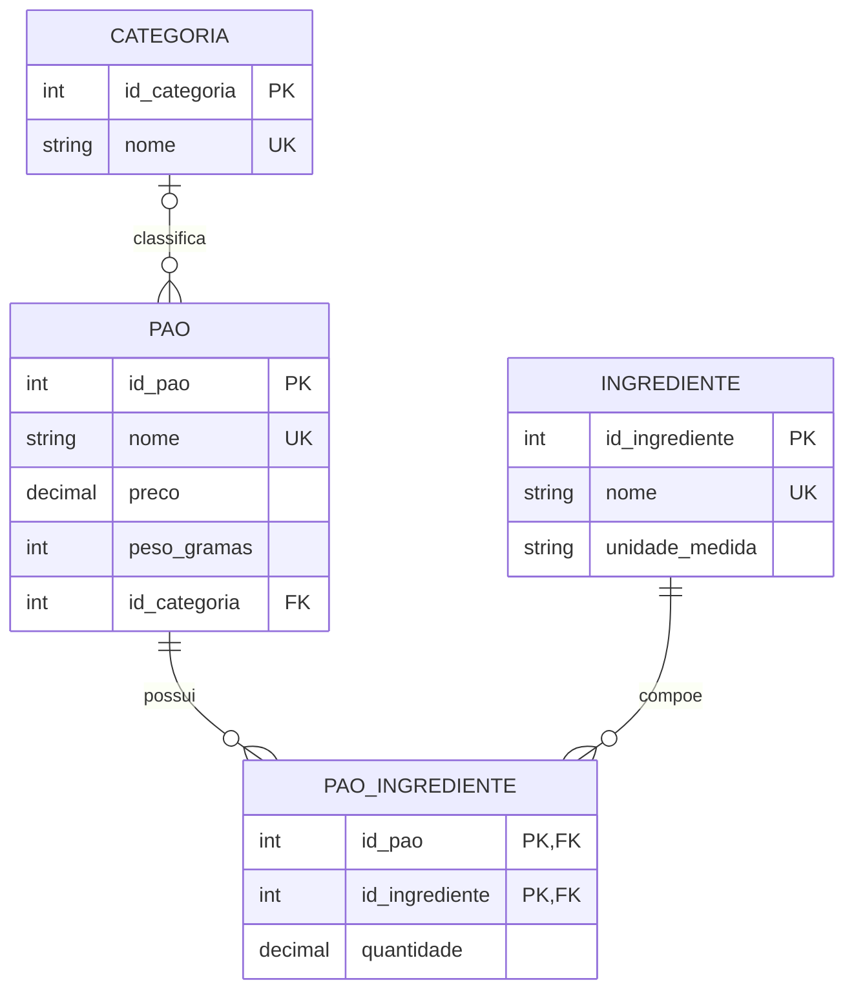

# Arquitetura e modelo entidade-relacionamento

## Domínio do problema

O objetivo é organizar categorias de pães, cadastro de produtos, ingredientes e
composição das receitas. A tabela `pao_ingrediente` implementa a relação N:N.

Uma categoria pode classificar diversos pães. Um pão pode estar sem categoria,
representado por `pao.id_categoria IS NULL`, conforme a opcionalidade do modelo
conceitual mostrado no PDF. Um pão pode combinar diversos ingredientes e um
ingrediente pode pertencer a diferentes receitas. A PK composta
`(id_pao, id_ingrediente)` impede repetição do mesmo ingrediente na receita.

## Responsabilidades das camadas

1. `resources/migrations/sqlite`: esquema persistente, restrições e índices;
   `migrations.py` aplica as alterações transacionalmente.
2. `database.py`: abertura de conexão e habilitação de FKs no SQLite.
3. `seed.py`: valida os exemplos em CSV e faz UPSERT sem apagar dados próprios.
4. `repository.py`: concentra SQL de leitura e mapeamento de linhas.
5. `analytics.py`: calcula indicadores, filtros e agregações, sem acoplar ao UI.
6. `export.py`: serializa as visões em CSV, independente do dashboard.
7. `cli.py` e `dashboard.py`: duas interfaces sobre as mesmas regras de cálculo.

## Decisões

- **SQLite na execução local:** elimina a necessidade de configurar um servidor.
  O DDL MySQL foi mantido em `sql/mysql/` como alternativa de estudo, não como
  motor de execução da aplicação.
- **CSV como dados-fonte:** versões reproduzíveis; a carga não precisa ser
  gravada em código Python nem depende de planilhas externas não fornecidas.
- **Relatórios orientados a cadastros:** o projeto não tem tabelas de produção,
  vendas ou inventário. Um gráfico do 'uso dos ingredientes' conta em quantos
  pães cada ingrediente aparece, e não volume comprado nem consumido na fábrica.
- **Precisão monetária de apresentação:** preços são somados com `Decimal` na
  aplicação. O SQLite usa afinidade NUMERIC, enquanto MySQL usa DECIMAL(8,2).
- **Sem credenciais ou dados pessoais:** SQLite local e dados sintéticos.
- **Sem exclusões automáticas na carga:** UPSERT torna a importação repetível e
  preserva registros que usuários possam ter criado no banco.
